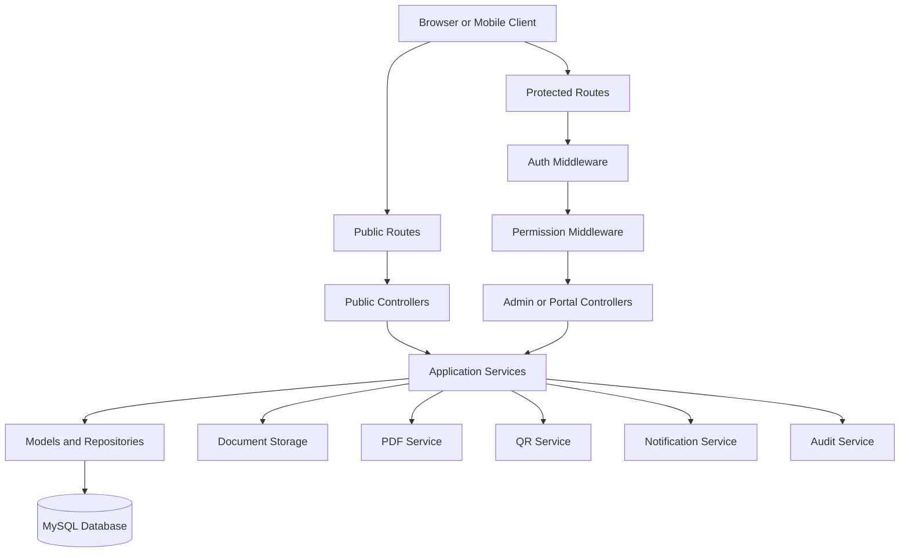

# GOF System Architecture

## Purpose
This document defines the target architecture for the Garko Orphans Foundation (GOF) web platform in the current `GOF2` codebase.

The system is a professional NGO management platform built as a modular PHP MVC application with strong separation of concerns, secure defaults, and room for future growth.

---

## 1. Architectural Style

GOF uses a **modular MVC monolith**.

This means:
- one deployable PHP application
- multiple domain modules
- shared authentication, routing, configuration, and UI systems
- clear separation between controllers, services, models, views, and infrastructure concerns

This is the right fit for the current project because it remains easy to deploy on common PHP hosting while still being maintainable and extensible.

---

## 2. High-Level Architecture

---

## 3. Application Zones

The system is divided into four access zones.

### 3.1 Public website
Used by visitors and the general public.

Includes:
- home
- about
- mission and vision
- programs and projects
- events
- news
- gallery
- donate
- volunteer
- contact
- FAQ
- privacy policy
- terms
- ID verification page

### 3.2 Administrative zone
Used by super admin and authorized staff.

Includes:
- dashboard
- user and role management
- beneficiary operations
- donor and donation operations
- programs and projects
- content management
- ID card administration
- notifications
- reports
- audit logs
- settings
- backups

### 3.3 Self-service portal zone
Used by donors and beneficiaries with restricted access.

Includes:
- own profile
- own donation history and receipts for donors
- own profile and assigned/public information for beneficiaries
- own ID card view where enabled
- own notifications

### 3.4 Verification zone
Used for public QR and ID verification.

This zone must expose only privacy-safe verification data.

---

## 4. Layered Structure

### 4.1 Presentation layer
Responsible for UI rendering and user interaction.

Includes:
- public pages
- admin dashboard views
- beneficiary portal views
- donor portal views
- reusable UI components

### 4.2 Controller layer
Responsible for:
- receiving requests
- validating request intent
- coordinating services
- selecting views or redirects
- returning JSON when needed

Controllers should remain thin and avoid holding business logic.

### 4.3 Service layer
Responsible for business logic and multi-step workflows.

Examples:
- login workflow
- beneficiary approval workflow
- donation confirmation
- ID card generation
- QR verification
- notifications
- audit logging
- report assembly

### 4.4 Persistence layer
Responsible for:
- database access
- query reuse
- transactional operations
- record lookup and persistence

Current project uses PDO and model classes. That remains acceptable.

### 4.5 Infrastructure layer
Responsible for integration concerns.

Includes:
- file storage
- PDF generation
- QR code generation
- email integration
- backup generation
- logging

---

## 5. Core Design Principles

### 5.1 Secure by default
- all protected routes require authentication
- all sensitive actions require permission checks
- CSRF protection on all state-changing forms
- prepared statements for all database operations
- passwords stored only as hashes
- private documents not publicly exposed

### 5.2 Privacy by default
Beneficiary data is sensitive.

Public views and QR verification must never expose:
- guardian details
- address
- welfare history
- education performance details unless intentionally private and internal
- private documents
- internal notes

### 5.3 Modular growth
New modules such as volunteer accounts, payment gateways, multi-branch support, API endpoints, and mobile apps should be addable without redesigning the entire system.

### 5.4 Archive over destructive delete
Core records like beneficiaries, donors, staff, donations, and ID cards should use status and archive workflows instead of unsafe permanent deletes.

### 5.5 Consistent business identifiers
All GOF identity numbers must be generated centrally and guarded by unique constraints.

---

## 6. Domain Model Direction

The recommended model is:
- `users` for authentication identities
- `staff`, `beneficiaries`, and `donors` for domain-specific profiles

This matches the current codebase and is more practical than forcing a polymorphic person model into an incomplete project.

### Why this model is preferred
- easier to maintain in plain PHP
- works with existing controllers and services
- keeps authentication concerns separate from operational records
- supports optional accounts for donors and beneficiaries

---

## 7. Request Lifecycle

Typical protected request lifecycle:

1. request enters `public/index.php`
2. bootstrap loads configuration and session
3. router matches request
4. auth middleware checks login state
5. permission middleware checks authorization
6. controller validates input and calls service(s)
7. service interacts with model(s), storage, and logging
8. response is rendered or redirected

---

## 8. Route Organization Direction

The current project uses a single route file. This is acceptable short-term, but the target structure is:
- `routes/public.php`
- `routes/admin.php`
- `routes/beneficiary.php`
- `routes/donor.php`
- `routes/api.php`
- `routes/web.php` as the composition entry point

This keeps routing maintainable as the project grows.

---

## 9. UI and Experience Architecture

### Admin UI
- sidebar navigation
- topbar with profile and notifications
- dashboard cards and charts
- searchable tables
- responsive forms
- clear flash messages and validation states

### Public UI
- modern NGO website presentation
- strong visual hierarchy
- clear calls to action
- professional content sections
- mobile-first responsiveness

### Portal UI
- simplified focused navigation
- role-appropriate information density
- no access to administrative sections

---

## 10. Security Architecture

### Authentication
- session-based authentication
- session regeneration on login
- inactivity timeout
- rate limiting via login attempts and optional IP blocking
- secure password reset tokens

### Authorization
- super admin full access
- role-based permission model for staff
- self-service permissions for donors and beneficiaries
- server-side enforcement on every protected action

### Input and output safety
- validate all input
- escape all output
- whitelist file upload types
- validate size and MIME type
- avoid predictable public file access

### Auditability
Every sensitive operation should create an audit log entry.

---

## 11. Storage Architecture

### Public assets
Stored under `public/assets`.

### Uploaded content
Store sensitive documents under `storage/documents`.

### Generated artifacts
- ID card PDFs: `storage/idcards`
- QR assets: `storage/qr`
- backups: `storage/backups`
- logs: `storage/logs`

Where possible, direct web access to private storage should be blocked.

---

## 12. Scalability and Future Readiness

The architecture should support future additions including:
- volunteer user accounts
- payment gateway integration
- SMS and email notifications
- API endpoints
- multi-branch or branch-based filtering
- public fundraising campaigns
- advanced analytics
- localization and multi-language support

---

## 13. Known Current Codebase Gaps

The current `GOF2` codebase already contains a good foundation, but these gaps must be accounted for during implementation:
- duplicate and conflicting migration tracks
- inconsistent permission vocabulary
- route references to missing controllers such as `PublicController` and `DocumentsController`
- mixed schema conventions for auth and ID card verification
- incomplete public website implementation

---

## 14. Canonical Implementation Decisions

The architecture is finalized with these decisions:

1. use numbered modular migrations as the canonical schema track
2. retire duplicate dated migrations after their useful parts are merged
3. keep `users` as the authentication table
4. keep `staff`, `beneficiaries`, and `donors` as separate profile tables
5. keep `projects` separate from `programs`
6. use token-based QR verification, not raw GOF ID only
7. default to archive and status transitions instead of hard delete
8. keep private documents access-controlled and non-public by default

---

## 15. Implementation Phases

The implementation should continue in this order:

1. architecture and requirements confirmation
2. database schema consolidation
3. folder and routing cleanup
4. authentication and RBAC hardening
5. public website completion
6. admin dashboard stabilization
7. staff management
8. beneficiary lifecycle completion
9. support and education management
10. donor and donation management
11. ID card and verification completion
12. programs, projects, events, news, and gallery
13. reports, notifications, and audit expansion
14. security hardening
15. testing and deployment documentation
