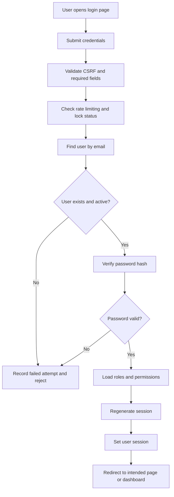
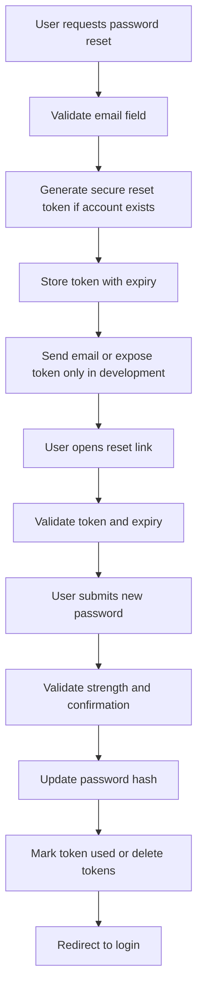
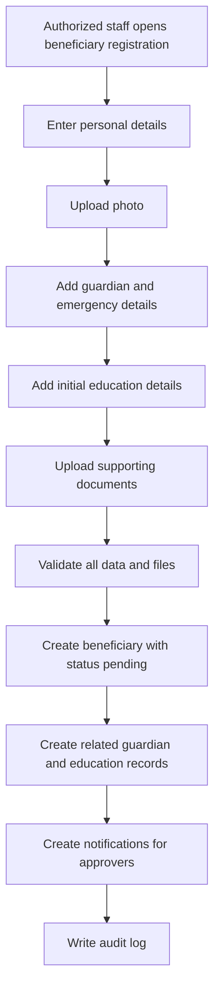
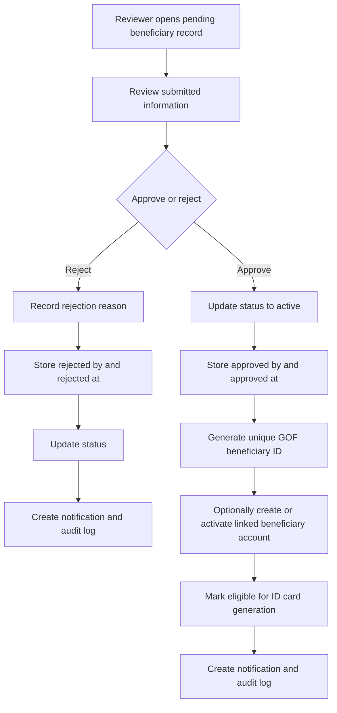
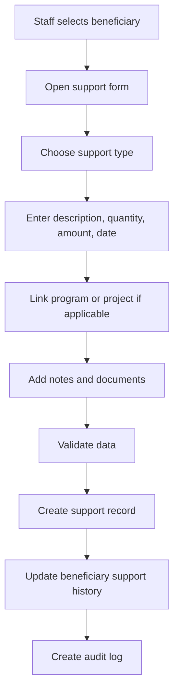
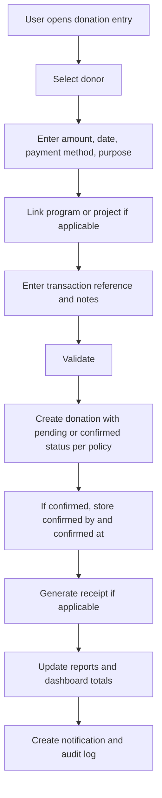
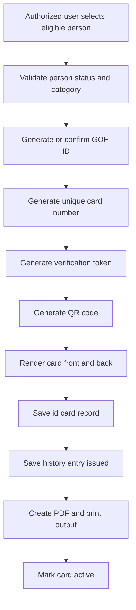
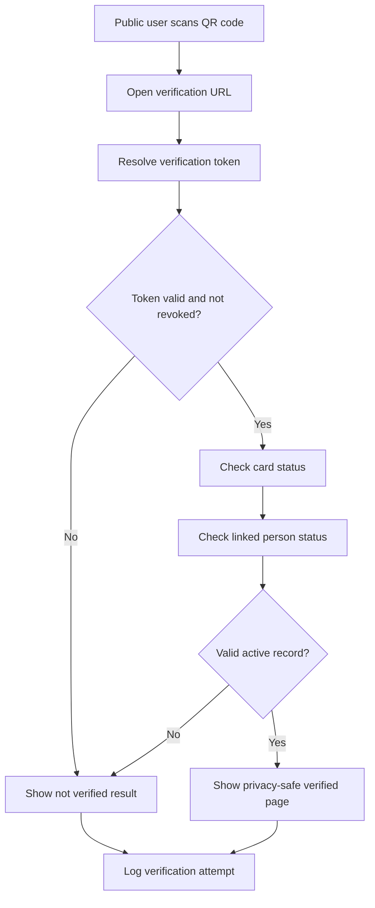

# GOF Major System Workflows

This document defines the primary business workflows for the GOF platform.

---

## 1. Authentication Workflow

### Key rules
- never store plaintext passwords
- always regenerate session on successful login
- always enforce account status and lock checks
- always record failed attempts

---

## 2. Password Reset Workflow

---

## 3. Staff Creation Workflow

1. super admin opens staff creation form
2. enters staff profile data
3. creates linked user account
4. assigns one or more roles
5. optionally assigns direct permission overrides
6. system generates unique staff GOF ID
7. staff record becomes active or pending based on policy
8. audit log entry is created
9. optional notification is created

---

## 4. Beneficiary Registration Workflow

### Important rules
- no GOF beneficiary ID should be generated before approval
- uploaded files must be validated by extension, MIME type, and size
- private beneficiary information must never be made public

---

## 5. Beneficiary Approval Workflow

---

## 6. Beneficiary Status Change Workflow

1. authorized user selects beneficiary
2. chooses a new status
3. system validates permission and transition rules
4. system stores new status
5. if archived, stores archived metadata
6. system writes audit log
7. dashboards and reports reflect new status

Supported states:
- pending
- active
- inactive
- suspended
- transferred
- graduated
- archived
- optional rejected

---

## 7. Support Record Workflow

---

## 8. Education Record Workflow

1. authorized staff opens beneficiary education section
2. chooses add or edit education record
3. enters institution details and academic session
4. enters level, enrollment status, and remarks
5. optionally attaches school-related documents
6. system validates and saves the record
7. system preserves history rather than overwriting unrelated past records
8. system creates audit log entry

---

## 9. Donor Registration Workflow

1. authorized user opens donor form
2. selects donor type: individual or organization
3. enters donor details
4. optionally creates linked donor account
5. system generates unique donor GOF ID
6. donor is stored with active or pending status
7. system writes audit log

---

## 10. Donation Recording Workflow

### Key rules
- donation status must not be falsely marked as successful
- staff confirmation should be explicit unless a trusted future payment gateway confirms it

---

## 11. Receipt Generation Workflow

1. locate confirmed donation
2. assemble donor and donation data
3. generate receipt number if absent
4. render receipt view or PDF
5. store file if archival is needed
6. expose receipt only to authorized staff and the owning donor

---

## 12. Program and Project Workflow

### Program creation
1. create program metadata
2. assign manager
3. set objectives, dates, and budget
4. define public visibility
5. save and audit log

### Project creation
1. create project
2. optionally link to program
3. assign manager
4. define timeline and budget
5. save and audit log

### Beneficiary assignment
1. choose program or project
2. select beneficiary
3. validate no duplicate assignment
4. create linking record
5. log action

---

## 13. Event Workflow

1. create event with title, date, location, and description
2. upload event image if provided
3. choose visibility or publication state
4. publish for public listing if appropriate
5. update to ongoing or completed as event lifecycle changes
6. write audit log

---

## 14. News Workflow

1. create draft article
2. enter title, slug, category, excerpt, content, and featured image
3. save as draft
4. authorized content manager publishes or archives article
5. published article becomes visible on public site
6. system writes audit log

---

## 15. Gallery Workflow

1. create album
2. optionally link album to event
3. upload validated images
4. add captions and sorting
5. mark album and images public or internal
6. save and log

---

## 16. ID Card Generation Workflow

### Applies to
- beneficiary
- staff
- donor
- future volunteer

---

## 17. ID Card Reissue and Revocation Workflow

### Reissue
1. locate existing card
2. decide reprint versus replacement
3. if replacement, mark old card as replaced
4. create new token and refreshed output
5. increment reissue or reprint tracking
6. save history
7. audit log

### Revocation
1. select active card
2. enter revocation reason
3. revoke current token
4. mark card revoked
5. create history entry
6. create audit log

---

## 18. QR Verification Workflow

### Public result may show only
- verified or not verified
- full name
- category
- GOF ID
- status

### Must never show publicly
- address
- guardian data
- private notes
- support history
- internal documents
- donation details

---

## 19. Notification Workflow

1. system event occurs
2. target user or users are identified
3. notification record is created
4. user sees unread counter
5. user can mark one read or all read

Typical triggers:
- new pending beneficiary
- donation recorded
- new volunteer application
- ID card generated
- expiring card
- important announcement

---

## 20. Contact Message Workflow

1. public user submits contact form
2. system validates inputs and stores message
3. status defaults to unread
4. authorized staff reviews message
5. status becomes read, replied, or archived
6. system logs important handling actions if needed

---

## 21. Volunteer Application Workflow

1. public user submits volunteer application
2. system validates and stores application
3. status defaults to pending
4. authorized reviewer opens application
5. reviewer updates status to reviewed, approved, rejected, or contacted
6. future account conversion may be added without redesign

---

## 22. Reporting Workflow

1. user opens report module
2. system validates report permission
3. user sets filters
4. system queries relevant data
5. system renders report page
6. optional print or PDF export
7. export action is auditable where necessary

---

## 23. Backup Workflow

1. authorized admin starts backup
2. system validates permission
3. database dump or export is generated where environment allows
4. file is stored in protected backup storage
5. metadata is recorded if backup tracking exists
6. audit log entry is created

---

## 24. Global Workflow Rules

These rules apply across the platform.

1. every protected action must validate authentication
2. every protected action must validate permission
3. every state-changing form must validate CSRF token
4. every sensitive action should be logged
5. every file upload must be validated by type and size
6. private records must never leak into public pages
7. public statistics must use approved aggregated data only
