# GOF Database Design

This document defines the canonical database design for the GOF platform and explains how it maps to the current `GOF2` project.

---

## 1. Database Design Goals

The GOF database must be:
- normalized
- secure
- maintainable
- indexed for common queries
- compatible with MySQL 8+
- appropriate for an NGO management platform with private beneficiary data

The design must support:
- role-based users
- beneficiaries and their case history
- donors and donations
- programs and projects
- ID cards and QR verification
- notifications and audit logs
- public website content

---

## 2. Core Data Modeling Approach

The canonical model uses:
- `users` for login identities
- separate profile tables for `staff`, `beneficiaries`, and `donors`

This approach is recommended because it fits the current codebase and avoids overcomplicating the application with an abstract person engine too early.

### Advantages
- clean separation between authentication and domain records
- easy support for optional donor and beneficiary accounts
- clear permission boundaries
- straightforward integration with the current MVC structure

---

## 3. Canonical Entity Groups

## 3.1 Authentication and RBAC
- `users`
- `roles`
- `permissions`
- `role_permissions`
- `user_roles`
- `user_permissions`
- `password_resets`
- `login_attempts`

## 3.2 Operational entities
- `staff`
- `beneficiaries`
- `guardians`
- `education_records`
- `beneficiary_support`
- `donors`
- `donations`
- `programs`
- `projects`
- `program_beneficiaries`
- `project_beneficiaries`
- `events`
- `news`
- `gallery_albums`
- `gallery_images`
- `documents`

## 3.3 Identity and verification
- `sequences`
- `id_cards`
- `id_card_history`
- `id_card_tokens`
- `verification_attempts`
- `blocked_ips`

## 3.4 Communication and governance
- `notifications`
- `contact_messages`
- `volunteer_applications`
- `audit_logs`
- `settings`
- `backups` optional metadata table

---

## 4. Entity Relationship Overview

```mermaid
erDiagram
    USERS ||--o{ USER_ROLES : has
    ROLES ||--o{ USER_ROLES : assigned
    ROLES ||--o{ ROLE_PERMISSIONS : grants
    PERMISSIONS ||--o{ ROLE_PERMISSIONS : belongs
    USERS ||--o{ USER_PERMISSIONS : overrides

    USERS ||--o| STAFF : owns
    USERS ||--o| BENEFICIARIES : owns
    USERS ||--o| DONORS : owns

    BENEFICIARIES ||--o{ GUARDIANS : has
    BENEFICIARIES ||--o{ EDUCATION_RECORDS : has
    BENEFICIARIES ||--o{ BENEFICIARY_SUPPORT : receives
    BENEFICIARIES ||--o{ PROGRAM_BENEFICIARIES : joins
    BENEFICIARIES ||--o{ PROJECT_BENEFICIARIES : joins

    DONORS ||--o{ DONATIONS : makes
    PROGRAMS ||--o{ DONATIONS : linked
    PROJECTS ||--o{ DONATIONS : linked

    PROGRAMS ||--o{ PROJECTS : contains
    PROGRAMS ||--o{ PROGRAM_BENEFICIARIES : includes
    PROJECTS ||--o{ PROJECT_BENEFICIARIES : includes

    EVENTS ||--o{ GALLERY_ALBUMS : related
    GALLERY_ALBUMS ||--o{ GALLERY_IMAGES : contains

    USERS ||--o{ NOTIFICATIONS : receives
    USERS ||--o{ AUDIT_LOGS : performs
    USERS ||--o{ STAFF : creates
    USERS ||--o{ BENEFICIARIES : creates
    USERS ||--o{ DONORS : registers

    ID_CARDS ||--o{ ID_CARD_HISTORY : records
    ID_CARDS ||--o{ ID_CARD_TOKENS : has
```

---

## 5. Table-by-Table Design

## 5.1 `users`
Purpose: authentication identities.

Recommended columns:
- `id`
- `uuid` optional
- `email` unique
- `password_hash`
- `account_type`
- `status`
- `first_name` optional
- `last_name` optional
- `phone` optional
- `photo` optional
- `email_verified_at` nullable
- `last_login_at` nullable
- `failed_login_attempts`
- `locked_until` nullable
- `remember_token` nullable
- `created_at`
- `updated_at`

### Canonical enums
`account_type`:
- `super_admin`
- `staff`
- `beneficiary`
- `donor`

`status`:
- `pending`
- `active`
- `inactive`
- `suspended`
- `archived`

### Notes for current codebase
Current migrations conflict between `password_hash` and `password` naming. The canonical field should be `password_hash`.

---

## 5.2 `roles`
Purpose: named permission bundles.

Recommended columns:
- `id`
- `name`
- `slug` unique
- `description`
- `is_system`
- timestamps

### Decision
Prefer `slug` as the stable identifier. Human-readable labels can be generated from `name` or stored separately if needed.

---

## 5.3 `permissions`
Purpose: atomic authorization rules.

Recommended columns:
- `id`
- `slug` unique
- `name`
- `module`
- `description`
- `created_at`

---

## 5.4 `role_permissions`
Composite table linking roles to permissions.

Columns:
- `role_id`
- `permission_id`

Primary key:
- `(role_id, permission_id)`

---

## 5.5 `user_roles`
Purpose: assign roles to users.

Columns:
- `user_id`
- `role_id`
- `assigned_by`
- `assigned_at`

Primary key:
- `(user_id, role_id)`

---

## 5.6 `user_permissions`
Purpose: per-user permission overrides.

Columns:
- `id`
- `user_id`
- `permission_id`
- `granted`
- `granted_by`
- `created_at`

Unique key:
- `(user_id, permission_id)`

---

## 5.7 `password_resets`
Purpose: secure password reset workflow.

Columns:
- `id`
- `email`
- `token`
- `created_at`
- `expires_at`
- `used_at` nullable

---

## 5.8 `login_attempts`
Purpose: rate limiting and security analytics.

Canonical columns:
- `id`
- `email`
- `ip_address`
- `successful`
- `user_agent`
- `created_at`

### Important implementation note
The current code queries different field names than some migrations provide. This must be standardized during implementation.

---

## 5.9 `staff`
Purpose: staff profile and employment identity.

Recommended columns:
- `id`
- `user_id` unique nullable
- `gof_id` unique
- `full_name`
- `gender`
- `date_of_birth` nullable
- `phone`
- `email` nullable
- `address`
- `state`
- `lga`
- `designation`
- `department`
- `employment_date`
- `photo`
- `status`
- `created_by`
- `created_at`
- `updated_at`

---

## 5.10 `beneficiaries`
Purpose: core beneficiary records.

Recommended columns:
- `id`
- `user_id` unique nullable
- `gof_id` unique nullable until approval, or generated only upon approval
- `full_name`
- `photo`
- `date_of_birth`
- `gender`
- `phone`
- `address`
- `state`
- `lga`
- `registration_date`
- `status`
- `created_by`
- `approved_by`
- `approved_at`
- `rejected_by`
- `rejected_at`
- `rejection_reason`
- `archived_by`
- `archived_at`
- `notes`
- `created_at`
- `updated_at`

### Status values
- `pending`
- `active`
- `inactive`
- `graduated`
- `transferred`
- `suspended`
- `archived`
- optional `rejected`

---

## 5.11 `guardians`
Purpose: store structured guardian and emergency-related records.

Recommended columns:
- `id`
- `beneficiary_id`
- `full_name`
- `relationship`
- `phone`
- `email`
- `address`
- `occupation`
- `is_primary`
- `is_emergency`
- `created_at`
- `updated_at`

---

## 5.12 `education_records`
Purpose: beneficiary educational history.

Recommended columns:
- `id`
- `beneficiary_id`
- `institution_name`
- `institution_type`
- `course_level`
- `academic_session`
- `enrollment_status`
- `performance`
- `remarks`
- `start_date`
- `end_date`
- `created_by`
- `created_at`
- `updated_at`

### Principle
Do not overwrite history when a beneficiary changes school or academic level. Keep multiple records.

---

## 5.13 `beneficiary_support`
Purpose: full assistance history for beneficiaries.

Recommended columns:
- `id`
- `beneficiary_id`
- `program_id` nullable
- `project_id` nullable
- `support_type`
- `description`
- `quantity` nullable
- `amount` nullable
- `currency`
- `support_date`
- `recorded_by_user_id`
- `status`
- `notes`
- `created_at`
- `updated_at`

### Support types
- `education`
- `food`
- `clothing`
- `medical`
- `financial`
- `materials`
- `shelter`
- `other`

---

## 5.14 `donors`
Purpose: donor profiles.

Recommended columns:
- `id`
- `user_id` unique nullable
- `gof_id` unique
- `name`
- `organization_name` nullable
- `donor_type`
- `email`
- `phone`
- `address`
- `country`
- `status`
- `notes`
- `registered_by`
- `created_at`
- `updated_at`

### Current migration note
Current schema uses `donor_code`. Canonical name should be `gof_id` for consistency.

---

## 5.15 `donations`
Purpose: financial transaction records associated with donors.

Recommended columns:
- `id`
- `donation_ref` unique
- `donor_id`
- `program_id` nullable
- `project_id` nullable
- `amount`
- `currency`
- `donation_date`
- `payment_method`
- `transaction_ref` nullable
- `purpose`
- `status`
- `notes`
- `receipt_number` unique nullable
- `recorded_by`
- `confirmed_by`
- `confirmed_at`
- `created_at`
- `updated_at`

### Status values
- `pending`
- `confirmed`
- `cancelled`
- `refunded`

---

## 5.16 `programs`
Purpose: top-level NGO initiatives.

Recommended columns:
- `id`
- `program_code` unique
- `name`
- `description`
- `objectives`
- `start_date`
- `end_date`
- `status`
- `budget`
- `currency`
- `manager_id`
- `is_public`
- `created_by`
- `created_at`
- `updated_at`

---

## 5.17 `projects`
Purpose: project entities that may exist within or alongside programs.

Recommended columns:
- `id`
- `program_id` nullable
- `project_code` unique
- `name`
- `description`
- `objectives`
- `start_date`
- `end_date`
- `status`
- `budget`
- `currency`
- `manager_id`
- `is_public`
- `created_by`
- `created_at`
- `updated_at`

### Design decision
Projects remain separate from programs.

---

## 5.18 `program_beneficiaries`
Columns:
- `program_id`
- `beneficiary_id`
- `joined_at`

Primary key:
- `(program_id, beneficiary_id)`

---

## 5.19 `project_beneficiaries`
Columns:
- `project_id`
- `beneficiary_id`
- `joined_at`

Primary key:
- `(project_id, beneficiary_id)`

---

## 5.20 `events`
Purpose: NGO events and activities.

Recommended columns:
- `id`
- `title`
- `slug` nullable unique
- `description`
- `location`
- `event_date`
- `end_date`
- `status`
- `is_public`
- `featured_image`
- `created_by`
- `created_at`
- `updated_at`

---

## 5.21 `news`
Purpose: public articles and announcements.

Recommended columns:
- `id`
- `title`
- `slug` unique
- `excerpt`
- `content`
- `featured_image`
- `category`
- `status`
- `published_at`
- `author_id`
- `created_at`
- `updated_at`

---

## 5.22 `gallery_albums`
Recommended columns:
- `id`
- `name`
- `description`
- `cover_image`
- `event_id` nullable
- `is_public`
- `created_by`
- `created_at`
- `updated_at`

---

## 5.23 `gallery_images`
Recommended columns:
- `id`
- `album_id`
- `filename`
- `caption`
- `is_public`
- `sort_order`
- `uploaded_by`
- `created_at`
- `updated_at`

---

## 5.24 `documents`
Purpose: secure files associated with system records.

Recommended columns:
- `id`
- `entity_type`
- `entity_id`
- `document_type`
- `original_name`
- `stored_name`
- `mime_type`
- `file_size`
- `storage_path`
- `visibility`
- `status`
- `description`
- `uploaded_by`
- `created_at`
- `updated_at`

### Visibility values
- `private`
- `internal`
- `owner_only`
- `public`

Default should be `private`.

---

## 5.25 `sequences`
Purpose: central ID sequence generation.

Columns:
- `name`
- `last_val`

Used for:
- beneficiary IDs
- staff IDs
- donor IDs
- future volunteer IDs

---

## 5.26 `id_cards`
Purpose: current and historical ID card records.

Recommended columns:
- `id`
- `card_no` unique
- `person_type`
- `person_id`
- `gof_id`
- `issue_date`
- `expiry_date`
- `status`
- `generated_by`
- `reprint_count`
- `current_token_id` nullable
- `pdf_path` nullable
- `created_at`
- `updated_at`

### Status values
- `active`
- `expired`
- `revoked`
- `replaced`

---

## 5.27 `id_card_history`
Purpose: ID card lifecycle history.

Columns:
- `id`
- `id_card_id`
- `action`
- `by_user_id`
- `reason`
- `action_at`

### Example actions
- `issued`
- `reprinted`
- `revoked`
- `expired`
- `replaced`
- `reactivated`
- `token_revoked`

---

## 5.28 `id_card_tokens`
Purpose: verification token history for cards.

Recommended columns:
- `id`
- `id_card_id`
- `token`
- `issued_by`
- `issued_at`
- `expires_at`
- `revoked`
- `revoked_by`
- `revoked_at`
- `revoke_reason`

### Security note
If implementation complexity permits, store hashed tokens rather than raw tokens.

---

## 5.29 `verification_attempts`
Purpose: tracking QR verification requests.

Recommended columns:
- `id`
- `id_card_id` nullable
- `token_id` nullable
- `ip_address`
- `user_agent`
- `result`
- `created_at`

---

## 5.30 `blocked_ips`
Purpose: block abusive verification or auth traffic.

Recommended columns:
- `id`
- `ip_address`
- `reason`
- `blocked_by`
- `expires_at` nullable
- `created_at`
- `updated_at`

---

## 5.31 `notifications`
Purpose: in-app notification center.

Recommended columns:
- `id`
- `user_id`
- `type`
- `title`
- `message`
- `link`
- `is_read`
- `read_at` nullable
- `created_at`

---

## 5.32 `contact_messages`
Purpose: public contact submissions.

Recommended columns:
- `id`
- `name`
- `email`
- `phone`
- `subject`
- `message`
- `status`
- `assigned_to` nullable
- `replied_at` nullable
- `archived_at` nullable
- `created_at`
- `updated_at`

---

## 5.33 `volunteer_applications`
Purpose: public volunteer interest pipeline.

Recommended columns:
- `id`
- `name`
- `email`
- `phone`
- `skills`
- `area_of_interest`
- `availability`
- `motivation`
- `status`
- `reviewed_by`
- `reviewed_at`
- `notes`
- `contacted_at` nullable
- `converted_user_id` nullable
- `created_at`
- `updated_at`

---

## 5.34 `audit_logs`
Purpose: immutable operational and security history.

Recommended columns:
- `id`
- `user_id` nullable
- `action`
- `module`
- `entity_type`
- `entity_id`
- `description`
- `ip_address`
- `user_agent`
- `created_at`

Optional enhancements:
- `severity`
- `metadata_json`

---

## 5.35 `settings`
Purpose: configurable organization and application settings.

Recommended columns:
- `id`
- `group_name`
- `key_name`
- `value`
- `type`
- `is_public`
- `updated_by`
- `created_at`
- `updated_at`

---

## 5.36 `backups`
Optional metadata table for backup tracking.

Recommended columns:
- `id`
- `filename`
- `storage_path`
- `size_bytes`
- `status`
- `created_by`
- `created_at`

---

## 6. Identifier Strategy

### GOF identity formats
- beneficiary: `GOF-ORP-00001`
- staff: `GOF-STF-00001`
- donor: `GOF-DON-00001`
- volunteer future: `GOF-VOL-00001`

### Rules
- generated centrally through `sequences`
- wrapped in a transaction
- sequence row locked during increment
- backed by unique constraints on target tables

---

## 7. Privacy and Exposure Rules

### Public website may expose only
- published news
- public events
- public gallery items
- public programs and projects
- approved aggregate statistics

### QR verification may expose only
- verification result
- name
- category
- GOF ID
- current status

### Public system must never expose
- guardian details
- private addresses
- support records
- private documents
- internal notes
- donation internals
- audit logs

---

## 8. Indexing Recommendations

Indexes should exist on:
- `users.email`
- `users.account_type`
- `users.status`
- `beneficiaries.gof_id`
- `beneficiaries.status`
- `beneficiaries.registration_date`
- `donors.gof_id`
- `donors.status`
- `donations.donation_ref`
- `donations.transaction_ref`
- `donations.status`
- `donations.donation_date`
- `programs.status`
- `projects.status`
- `id_cards.card_no`
- `id_cards.status`
- `id_card_tokens.token`
- `notifications.user_id, is_read`
- `audit_logs.user_id`
- `audit_logs.module`
- `audit_logs.created_at`

---

## 9. Migration Consolidation Notes for Current `GOF2`

The current project contains conflicting migration tracks.

### Recommended direction
Use the numbered modular migrations as the canonical base and merge useful additions from the dated migrations.

### Standardize these conflicts
- `password_hash` instead of `password`
- `ip_address` instead of mixed `ip`
- `successful` instead of mixed `success`
- `created_at` instead of mixed `attempted_at`
- `gof_id` instead of mixed `donor_code` or `staff_id` where the field is really a business identifier

### Important implementation goal
Schema, seed data, services, and route permissions must all use the same naming conventions.
